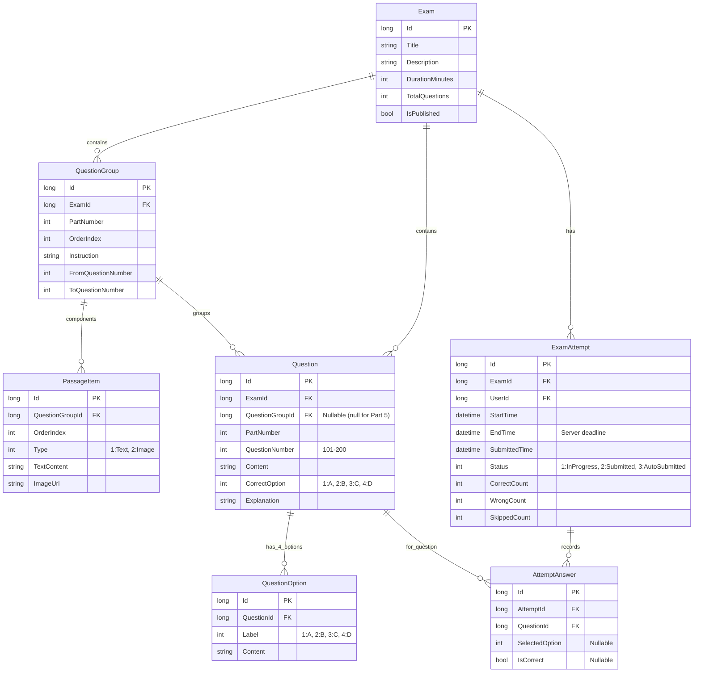

# TOEIC Reading Practice System — Backend Documentation

Hệ thống quản lý và luyện thi **TOEIC Reading** xây dựng trên nền tảng **ASP.NET Boilerplate (ABP Framework)**, **.NET 9**, **Entity Framework Core**, và **Microsoft SQL Server**.

---

## 1. Cấu Trúc Đề Thi TOEIC Reading (100 Câu - 75 Phút)

Hệ thống hỗ trợ cấu trúc phân cấp đặc thù của bài thi TOEIC Reading:
* **Part 5 (Câu 101 – 130, 30 câu):** Câu hỏi độc lập (Incomplete Sentences). Mỗi câu gồm một câu văn có chỗ trống `-------`, 4 lựa chọn (A, B, C, D) và đáp án đúng. Không có đoạn văn đi kèm (`QuestionGroupId = null`).
* **Part 6 (Câu 131 – 146, 16 câu):** Điền từ vào đoạn văn (Text Completion). Gồm các nhóm 4 câu, chia sẻ chung một đoạn văn (văn bản hoặc hình ảnh). Chỗ trống nằm trực tiếp bên trong đoạn văn (ví dụ: `-------131`).
* **Part 7 (Câu 147 – 200, 54 câu):** Đọc hiểu (Reading Comprehension). Các đoạn văn đơn hoặc đa văn bản (email + bài báo + biểu đồ), hỗ trợ nhiều khối văn bản và hình ảnh (`PassageItem`). Mỗi nhóm có từ 2 đến 5 câu hỏi phụ thuộc.

---

## 2. Kiến Trúc Phân Tầng ABP (Layering Architecture)

Tuân thủ nghiêm ngặt chuẩn kiến trúc ABP:

```
├── *.Core (Domain Layer)
│   ├── Entities/                 # Exam, QuestionGroup, PassageItem, Question, QuestionOption, ExamAttempt, AttemptAnswer
│   ├── Enums/                    # AnswerOption, AttemptStatus, PassageItemType
│   ├── Parsing/                  # IDocxParser, DocxParseModels (Intermediate DTOs & Result)
│   ├── Services/                 # IToeicScoringService, ToeicScoringService (Chuyển đổi điểm ETS 5-495)
│   └── Authorization/            # PermissionNames, KiemTraGiuaKyAuthorizationProvider
│
├── *.Application (Application Services Layer)
│   ├── Exams/
│   │   ├── IExamAppService.cs        # Quản lý đề thi, import .docx, preview, edit, publish (Giáo viên)
│   │   ├── ExamAppService.cs
│   │   ├── IExamAttemptAppService.cs # API học viên làm bài, bấm giờ, nộp bài, tính điểm (Học viên)
│   │   ├── ExamAttemptAppService.cs
│   │   ├── Dto/                      # ExamDtos.cs, AttemptDtos.cs
│   │   └── Services/DocxParser.cs    # Engine phân tích file Word với OpenXML SDK & validation nghiêm ngặt
│
├── *.EntityFrameworkCore (Infrastructure Layer)
│   ├── EntityFrameworkCore/
│   │   ├── KiemTraGiuaKyDbContext.cs # DbSets và cấu hình quan hệ cascade delete
│   │   ├── Configurations/           # Fluent API mapping cho từng entity
│   │   └── Seed/                     # Seed dữ liệu mặc định (Admin, Learner, Roles, Permissions)
│
├── *.Web.Host (Web API & UI Host)
│   ├── Controllers/
│   │   ├── ExamAdminController.cs   # API & Upload file dành cho Giáo viên
│   │   ├── MobileExamController.cs  # RESTful API dành cho Mobile App
│   │   └── HomeController.cs
│   └── wwwroot/
│       ├── admin/                   # Giao diện quản trị giáo viên (nhập đề, preview, edit)
│       └── learner/                 # Giao diện mô phỏng ứng dụng di động cho học viên
│
└── *.Tests (Unit Testing Layer)
    └── Exams/
        ├── DocxParser_Tests.cs      # Kiểm thử parser: thiếu tag, sai số câu, thiếu đáp án
        └── Grading_Tests.cs         # Kiểm thử thuật toán chấm điểm chuẩn ETS
```

---

## 3. Database Diagram & Thiết Kế Thực Thể

Tất cả các thực thể kế thừa từ `FullAuditedEntity<long>` (hỗ trợ Soft Delete, lưu lịch sử tạo/sửa). Khóa ngoại xóa tầng (`Cascade Delete`) từ `Exam` xuống tất cả các bảng liên quan.



---

## 4. Quy Chuẩn Tag File Word (.docx Tag Specification)

Tệp Word nhập vào hệ thống sử dụng quy chuẩn tag văn bản tường minh:

### Part 5 (Câu Đơn 101 – 130)
```text
[PART 5]
[QUESTION: 101] The marketing director requested that all team members submit their weekly reports ------- 5:00 PM on Friday.
[A] before
[B] ahead
[C] prior
[D] previous
[ANSWER: A]
[EXPLANATION] Giới từ "before" đi kèm mốc thời gian chỉ hành động phải hoàn thành trước thời điểm đó.
```

### Part 6 (Nhóm Đoạn Văn 131 – 146)
```text
[PART 6]
[GROUP: 131-134]
[INSTRUCTION] Questions 131-134 refer to the following email.
[PASSAGE]
To: All Staff <staff@company.com>
From: Human Resources <hr@company.com>
Subject: Annual Health Checkup

Please be reminded that the annual health screening will take place next Monday. All employees are required to participate -------131 in the main conference hall. If you have any scheduling conflicts, please contact your manager -------132.
[END_PASSAGE]

[QUESTION: 131]
[A] promptly
[B] prompt
[C] prompting
[D] promptness
[ANSWER: A]
[EXPLANATION] Cần trạng từ bổ nghĩa cho động từ "participate".

[QUESTION: 132]
[A] immediately
[B] immediate
[C] immediacy
[D] intermediately
[ANSWER: A]
[EXPLANATION] Trạng từ "immediately" bổ nghĩa cho cụm "contact your manager".
```

### Part 7 (Đoạn Văn Kèm Hình Ảnh 147 – 200)
```text
[PART 7]
[GROUP: 147-148]
[INSTRUCTION] Questions 147-148 refer to the following announcement and chart.
[PASSAGE]
[IMAGE]
Quarterly sales summary for regional branches.
[END_PASSAGE]

[QUESTION: 147] What is the purpose of the announcement?
[A] To announce new sales quotas
[B] To review branch performance
[C] To introduce new staff
[D] To schedule a meeting
[ANSWER: B]
[EXPLANATION] The document summarizes quarterly performance.
```

### Cơ chế kiểm tra lỗi (All-or-Nothing Validation)
Bộ bóc tách `DocxParser` thu thập **toàn bộ lỗi** trước khi trả về kết quả:
* Kiểm tra thứ tự tuần tự câu hỏi từ 101 đến 200 không bị ngắt quãng.
* Kiểm tra từng câu hỏi phải có đủ 4 lựa chọn [A], [B], [C], [D].
* Kiểm tra từng câu hỏi phải có đúng 1 thẻ `[ANSWER: X]`.
* Kiểm tra nhóm Part 6, Part 7 có đoạn văn đi kèm.

---

## 5. Danh Sách REST API & Mẫu Dữ Liệu

### A. Dành Cho Giáo Viên / Admin (`/api/admin/exams`)

| Phương thức | Endpoint | Chức năng | Quyền yêu cầu |
|---|---|---|---|
| `GET` | `/api/admin/exams` | Lấy danh sách đề thi | `Pages.Exams` |
| `GET` | `/api/admin/exams/{id}` | Lấy chi tiết đề thi kèm đáp án để preview & edit | `Pages.Exams` |
| `POST` | `/api/admin/exams/upload` | Upload file `.docx` nhập đề thi | `Pages.Exams.Import` |
| `PUT` | `/api/admin/exams/{id}` | Cập nhật tiêu đề, mô tả, thời gian thi | `Pages.Exams.Edit` |
| `PUT` | `/api/admin/exams/question` | Chỉnh sửa nội dung câu hỏi, đáp án đúng | `Pages.Exams.Edit` |
| `POST` | `/api/admin/exams/{id}/publish` | Đổi trạng thái Công bố / Ẩn đề | `Pages.Exams.Publish` |
| `DELETE` | `/api/admin/exams/{id}` | Xóa đề thi và các dữ liệu liên quan | `Pages.Exams.Delete` |

### B. Dành Cho Ứng Dụng Mobile / Học Viên (`/api/mobile`)

| Phương thức | Endpoint | Chức năng | Bảo mật |
|---|---|---|---|
| `GET` | `/api/mobile/exams` | Lấy danh sách các đề thi đã công bố | Public / Authorized |
| `GET` | `/api/mobile/exams/{id}` | Lấy nội dung đề thi để làm bài | **Ẩn tuyệt đối đáp án đúng & giải thích** |
| `POST` | `/api/mobile/attempts/start` | Bắt đầu làm bài, lấy deadline server | Lưu thời gian bắt đầu và kết thúc |
| `POST` | `/api/mobile/attempts/answer` | Lưu đáp án từng câu thời gian thực | Kiểm tra deadline server |
| `POST` | `/api/mobile/attempts/finish` | Nộp bài và chấm điểm ngay lập tức | Quy đổi điểm TOEIC 5-495 |
| `GET` | `/api/mobile/attempts/{id}/result`| Xem kết quả chi tiết & giải thích sau nộp | Chỉ xem được sau khi đã nộp bài |
| `GET` | `/api/mobile/attempts/my` | Xem lịch sử các lượt thi của học viên | Lọc theo User ID |

#### Mẫu Yêu Cầu & Phản Hồi:

**1. Bắt đầu làm bài:**
`POST /api/mobile/attempts/start`
```json
{
  "examId": 1
}
```
*Phản hồi:*
```json
{
  "attemptId": 42,
  "examId": 1,
  "examTitle": "TOEIC Reading ETS Test 01",
  "startTime": "2026-10-12T08:30:00Z",
  "endTime": "2026-10-12T09:45:00Z",
  "durationMinutes": 75,
  "totalQuestions": 100,
  "remainingSeconds": 4500
}
```

**2. Lưu đáp án trong khi thi:**
`POST /api/mobile/attempts/answer`
```json
{
  "attemptId": 42,
  "questionId": 101,
  "selectedOption": 1
}
```

**3. Nộp bài và nhận kết quả:**
`POST /api/mobile/attempts/finish`
```json
{
  "attemptId": 42
}
```
*Phản hồi:*
```json
{
  "summary": {
    "attemptId": 42,
    "examTitle": "TOEIC Reading ETS Test 01",
    "scaledScore": 415,
    "totalQuestions": 100,
    "correctCount": 90,
    "wrongCount": 8,
    "skippedCount": 2,
    "timeSpentSeconds": 4120
  },
  "part5": {
    "partName": "Part 5: Incomplete Sentences",
    "totalQuestions": 30,
    "correctCount": 28,
    "accuracyPercentage": 93.3
  },
  "part6": {
    "partName": "Part 6: Text Completion",
    "totalQuestions": 16,
    "correctCount": 15,
    "accuracyPercentage": 93.8
  },
  "part7": {
    "partName": "Part 7: Reading Comprehension",
    "totalQuestions": 54,
    "correctCount": 47,
    "accuracyPercentage": 87.0
  }
}
```

---

## 6. Hướng Dẫn Cấu Hình, Migration & Khởi Chạy

### 1. Cấu hình Chuỗi Kết Nối (`appsettings.json`)
Trong `src/KiemTraGiuaKy.Web.Host/appsettings.json`:
```json
"ConnectionStrings": {
  "Default": "Server=localhost; Database=KiemTraGiuaKyDb; Trusted_Connection=True; TrustServerCertificate=True;"
}
```

### 2. Chạy Migration Database
Mở Package Manager Console hoặc Terminal tại thư mục `aspnet-core`:
```powershell
# Chạy dự án Migrator để tự động tạo Database và seed tài khoản mặc định
dotnet run --project src/KiemTraGiuaKy.Migrator/KiemTraGiuaKy.Migrator.csproj
```
Hoặc dùng lệnh EF Core CLI:
```powershell
dotnet ef database update --project src/KiemTraGiuaKy.EntityFrameworkCore/KiemTraGiuaKy.EntityFrameworkCore.csproj --startup-project src/KiemTraGiuaKy.Web.Host/KiemTraGiuaKy.Web.Host.csproj
```

### 3. Tài Khoản Mặc Định (Seed Accounts)
* **Giáo viên / Admin:**
  * Tên đăng nhập: `admin`
  * Mật khẩu: `123qwe`
* **Học viên (Learner):**
  * Tên đăng nhập: `learner`
  * Mật khẩu: `123qwe`

### 4. Khởi Chạy Ứng Dụng
```powershell
dotnet run --project src/KiemTraGiuaKy.Web.Host/KiemTraGiuaKy.Web.Host.csproj
```
Khi ứng dụng khởi chạy thành công:
* **Admin Web Portal:** `https://localhost:44311/admin/index.html`
* **Learner Mobile Simulator:** `https://localhost:44311/learner/index.html`
* **Swagger API Documentation:** `https://localhost:44311/swagger`
